# ESP32 DeskHub v5.0.1 — Dokunmatik TFT Bilgi İstasyonu, MP3 İnternet Radyosu & 5× WS2812B LED

<p align="center">
  
  
  
  
  
</p>

**2.4" 320×240 (`TJCTM24024-SPI` ILI9341)** ve **Waveshare 4" 480×320 (`RPi LCD (A)` ILI9486 + XPT2046)** dokunmatik ekranlar, **PCM5102A I2S DAC** ile canlı **MP3 İnternet Radyosu**, **5× WS2812B adreslenebilir durum LED'i**, **Wi-Fi OTA güncelleme** ve **Aydınlık / Karanlık tema** destekli masaüstü bilgi ve ses istasyonu.

> 🌐 **[İnteraktif Wiki, Adım Adım Devre Kurulum Animasyonu & Tek Tıkla USB Web Flasher → `cnlm3d.github.io/masa-ustu-tft-bilgi-ekrani`](https://cnlm3d.github.io/masa-ustu-tft-bilgi-ekrani/)**
> Tarayıcıdan (Chrome/Edge) derleme yapmadan doğrudan USB üzerinden firmware yükleyebilir ve adım adım kablolama animasyonunu inceleyebilirsiniz.

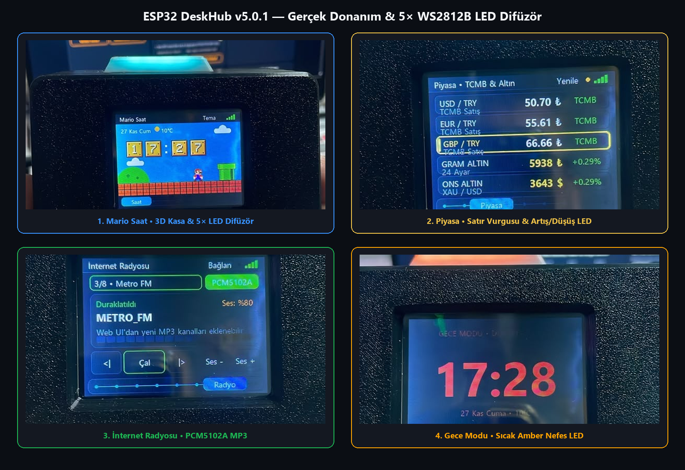

---

## Canlı Animasyonlar (GIF)

| Yaprak Saat (3D Gölgeli Dönüş) | Mario Saat (Dakika Zıplama & Kutu Vuruşu) | Tetris Saat (Yalnızca Değişen Hane Düşer) |
|:---:|:---:|:---:|
| 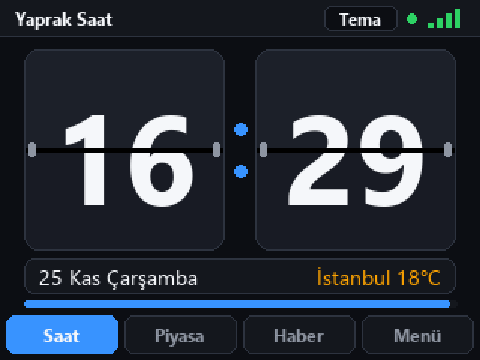 | 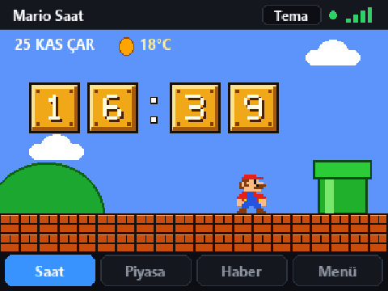 | 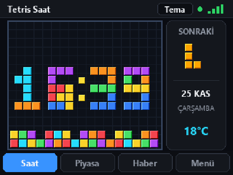 |

---

## Özellikler

### 7 Farklı Saat Teması
1. **Yaprak Saat (Flip Clock):** Her dakika/saat değişiminde 3D gölgeli mekanik yaprak dönme animasyonu, Türkçe tarih, alt hava özeti ve 60 sn ilerleme barı.
2. **Nixie Tüp Saat (IN-18):** Üst cam mühür ucu, cam yansımaları, anod kafesi ve ince tel-filament neon parlama.
3. **Dijital 7-Segment LED:** Saniyeli yüksek kontrastlı göstergeler (Aydınlık modda klasik Casio-LCD stili).
4. **Analog Rolex (Submariner):** Zümrüt-siyah/lacivert kadran, Mercedes akrep, büyüteçli tarih penceresi ve sağda dijital özet paneli.
5. **Analog Patek Philippe (Nautilus):** Sekizgen çelik kasa, yatay şeritli kadran ve 6 yönünde ay evresi alt kadranı.
6. **Mario Saat:** Orijinal 16×16 NES Mario piksel karakteri ve 42×42 `?` blokları; dakika başı zıplayarak kutuya vurur.
7. **Tetris Saat:** Sabit rakamlar yerinde kalır; sadece değişen hanenin tetromino blokları düşerek rakamı oluşturur.


<details>
<summary>2× Yakın Detay Görseli (Nixie, Mario Bekleme/Vuruş ve Tetris)</summary>


</details>

---

### v5.0.1 Akıllı Özellikler: İnternet Radyosu, 5× WS2812B LED & Sürgülü Arayüz

- **İnternet Radyosu (`PCM5102A` I2S + `libhelix` MP3):**
  - HTTP/HTTPS canlı MP3 (`audio/mpeg`) yayın çalma, **ICY şarkı/program bilgisi (`StreamTitle`)** ve 16 segment canlı stereo VU metre.
  - **8 canlı test edilmiş varsayılan kanal** (`JoyTürk`, `Süper FM`, `Metro FM`, `JoyTürk Akustik`, `Virgin Radio TR`, `Power Love`, `SomaFM Groove`, `Radio Paradise`).
  - **Web UI (`http://deskhub.local`)** üzerinden **16 kanala kadar** kendi MP3 linklerinizi ekleme, silme ve tek tıkla çalma (NVS kalıcı hafıza).
  - Radyo çalarken ses kesilmesini önlemek için arka plan HTTPS güncellemeleri otomatik duraklatılır.
- **5× Adreslenebilir LED Durum Çubuğu (`WS2812B` · RMT Donanım Sürücüsü):**
  - **Saat Ekranı:** Saniyede 1 kez (`1000 ms`) yumuşak nefes alma efekti.
  - **Hava Durumu Sayfası:** Güneşli (sıcak sarı ışıltı / gece ay mavisi), Bulutlu/Sisli (kayan buz mavisi dalga), Yağmur (koyu mavi üstünde düşen cyan damlalar), Kar (parıldayan kar taneleri), Fırtına (mor bulut + ani beyaz şimşek).
  - **Piyasa Sayfası:** `USD/TRY`, `EUR/TRY`, `GBP/TRY`, `Gram Altın` ve `Ons Altın` satırları sırayla (`2.5 sn`) veya dokunarak vurgulanır; aktif satır artışta **soldan sağa Yeşil dalga**, düşüşte **sağdan sola Kırmızı dalga** üretir.
  - **Alarm Çalıyor:** 5 LED yüksek dikkat **Şimşek efekti** + PCM5102A zil melodisi.
  - **Odak / Geri Sayım (Pomodoro):** Kalan süreye göre `5→1` kademeli bar (`Yeşil → Amber → Kırmızı`), mola modunda nefes alan mavi.
  - **Radyo Çalıyor:** Gerçek zamanlı 5 LED VU seviye çubuğu.
  - **Gece Modu:** Tüm 5 LED aynı anda yanarak `4 sn` periyotta göz yormayan kısık sıcak Amber nefes efekti.
  - **Wi-Fi / OTA:** Bağlantı kopuksa sarı tarama; Wi-Fi OTA yüklenirken mavi ilerleme barı.
- **Altta İnteraktif 9 Sayfalık Sürgü:** `Saat • Hava • Piyasa • Dünya • Alarm • Haber • Odak • Radyo • Menü` arasında parmakla sürükleyip bırakarak anında geçiş.
- **Aydınlık & Karanlık Tema:** TN `ILI9341` LCD için kalibre edilmiş yüksek kontrastlı Aydınlık tema ve Karanlık tema (NVS kalıcı).
- **45 sn Otomatik Döngü:** Ana Menü veya Web UI'dan açılarak `Saat → Hava → Piyasa` arasında her 45 saniyede bir döner.
- **Kablosuz Wi-Fi OTA Güncelleme:** Web UI (`/api/ota`) üzerinden `.bin` yükleme ve PlatformIO `ArduinoOTA` desteği.
- **Diğer Sayfalar:** Open-Meteo 3 günlük Hava Durumu, TCMB/Altın Piyasa, 4 Dünya Şehri, 3 Bağımsız Alarm (`Her Gün / Hafta İçi / Hafta Sonu`, `5 dk Ertele`), Google Haberler TR RSS (`Gündem, Teknoloji, Ekonomi, Bilim, Spor`) ve Pomodoro (`25/5` – `50/10`).

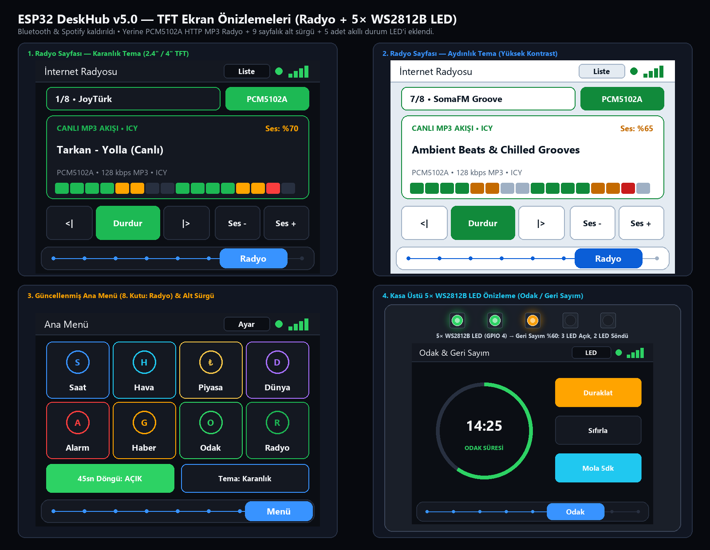


---

### Dahili Web Kontrol Paneli (`http://deskhub.local`)

ESP32 Wi-Fi'a bağlandığında `http://deskhub.local` (veya cihazın yerel IP adresi) üzerinden açılan Aydınlık/Karanlık uyumlu kontrol paneli:
- **İnternet Radyosu:** Canlı parça takibi, çal/durdur, ses slider'ı (`%0–100`), **16 kanala kadar özel MP3 kanal ekleme/silme**
- **5× WS2812B LED Kontrolü:** Aç/Kapat, Mod seçimi (`Otomatik`, `Radyo VU`, `Sabit Renk`, `Gece Amber`, `Kapalı`), Parlaklık limiti (`%10–80`), Renk seçici ve **Gökkuşağı Testi**
- **Sistem & Ekran:** 7 saat teması, 11 sayfa yönlendirme, Aydınlık/Karanlık tema, 45 sn döngü, 3 alarm, şehir/koordinat, haber kategorisi, 4 dünya şehri, Gece Modu, ekran döndürme (`0° / 180°`) ve tarayıcıdan **Wi-Fi OTA (`.bin`) güncelleme**

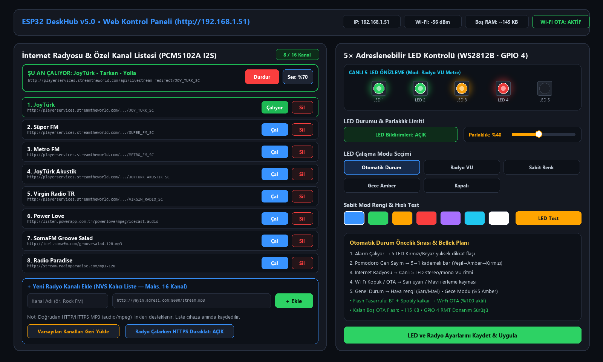

---

## Sistem Mimarisi

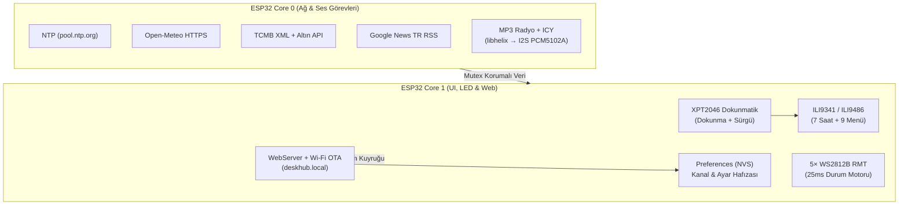

---

## Donanım Bağlantı Şeması

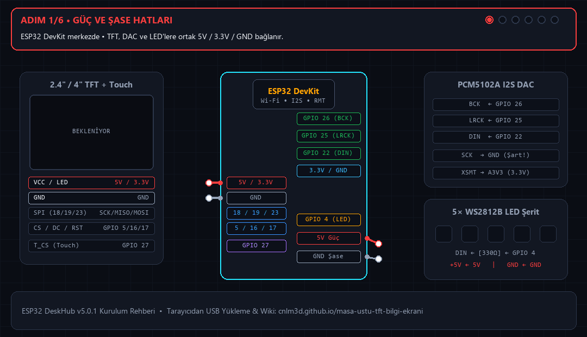

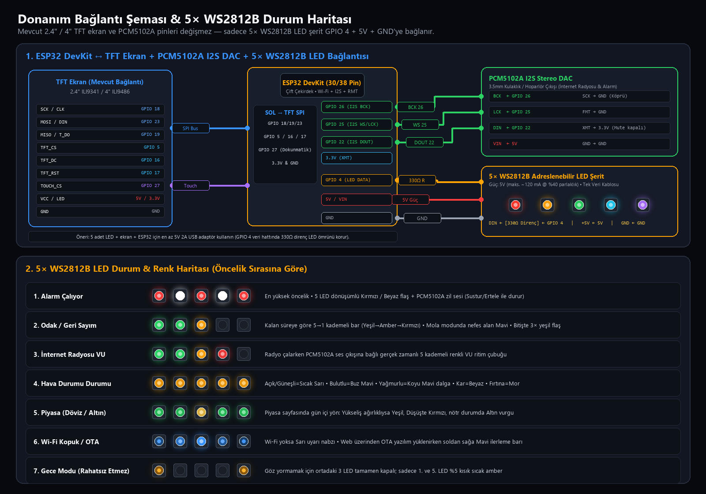

### 2.4" TFT (`TJCTM24024-SPI` ILI9341) & Ortak Pinler

| Ekran Pini | ESP32 DevKit (`esp32dev`) | ESP32-C3 Mini (`esp32c3`) | Açıklama |
|---|---|---|---|
| `VCC` | **5V (VIN)** | **5V (VBUS)** | Kart arkasındaki `U1` (3.3V regülatör) için 5V |
| `GND` | `GND` | `GND` | Ortak şase |
| `CS` / `RESET` / `DC` | `GPIO 5` / `17` / `16` | `GPIO 7` / `3` / `2` | TFT kontrol pinleri |
| `MOSI` / `MISO` / `SCK` | `GPIO 23` / `19` / `18` | `GPIO 6` / `5` / `4` | Paylaşılan SPI hattı (TFT + Touch) |
| `LED` | **3.3V** | **3.3V** | Arka ışık |
| `T_CS` | `GPIO 27` | `GPIO 10` | XPT2046 Dokunmatik Chip Select |

### Waveshare 4" RPi LCD (A) `480×320 ILI9486` (`esp32dev_4inch`)

| Waveshare 26-Pin | Sinyal | ESP32 DevKit (`esp32dev_4inch`) |
|---|---|---|
| Pin `1 / 17` (`3.3V`) / Pin `2 / 4` (`5V`) | Besleme | `3.3V` / `5V` |
| Pin `6 / 9 / 14 / 20 / 25` | `GND` | `GND` |
| Pin `18 / 22 / 24 / 26` | `DC / RST / LCD_CS / TP_CS` | `GPIO 16 / 17 / 5 / 27` |
| Pin `19 / 21 / 23` | `MOSI / MISO / SCK` | `GPIO 23 / 19 / 18` |

<details>
<summary>Waveshare 4" Arka 26-Pin Yerleşimi ve Gerçek Kart Haritası</summary>

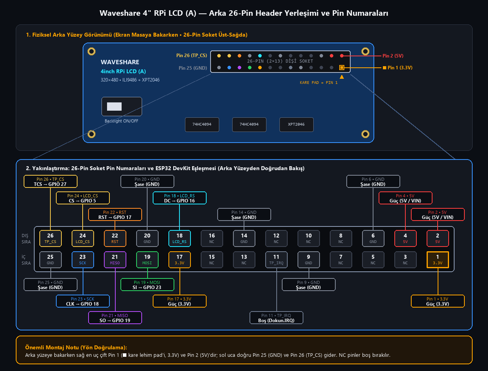

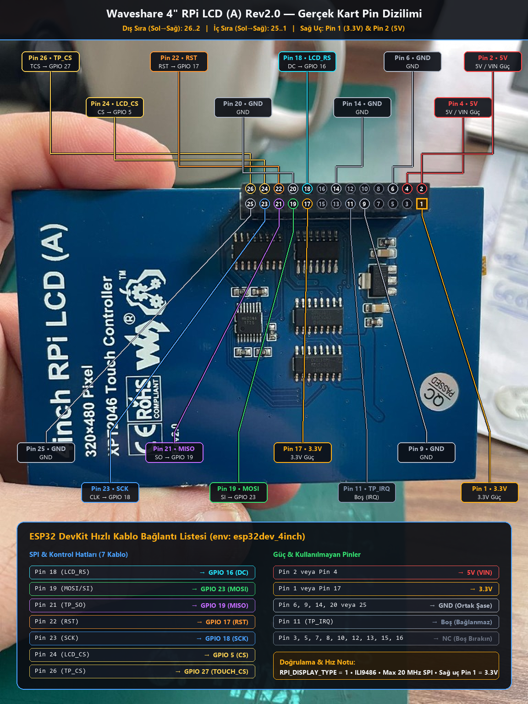

</details>

### PCM5102A I2S Stereo DAC & 5× WS2812B LED Bağlantısı

| Modül Pini | ESP32 DevKit (`esp32dev`) | ESP32-C3 (`esp32c3`) | Kritik Not |
|---|---|---|---|
| `PCM5102A VIN / GND` | `5V` / `GND` | `5V` / `GND` | Ortak besleme |
| `PCM5102A SCK` | **`GND`** | **`GND`** | **Mutlaka GND'ye bağlanmalı** (dahili PLL) |
| `PCM5102A BCK / LRCK / DIN` | `GPIO 26 / 25 / 22` | `GPIO 8 / 9 / 20` | I2S Saat, Sol/Sağ, Veri |
| `PCM5102A XSMT / XMT` | **`3.3V` (`A3V3` veya `H3L` köprüsü)** | **`3.3V`** | Mor `GY-PCM5102` kartlarda `XSMT → A3V3` köprüsü gerekir |
| `5× WS2812B DIN` | **`GPIO 4`** (`330Ω` direnç ile) | **`GPIO 1`** (`330Ω` direnç ile) | `+5V` ve `GND` ortak; `5V 2A` adaptör önerilir |

---

## Web UI REST API

| Uç Nokta | Metot | Açıklama |
|---|---|---|
| `/` | `GET` | Tek sayfalık Aydınlık/Karanlık uyumlu Web UI v5.0 |
| `/api/state` | `GET` | Tema, radyo kanalları/çalma durumu, LED, alarmlar, piyasa ve telemetri JSON |
| `/api/radio?act=...` | `POST` | `play&idx=`, `stop`, `toggle`, `next`, `prev`, `vol&v=`, `add` (JSON), `del&idx=`, `reset` |
| `/api/led` | `POST` | `?test=1` gökkuşağı testi veya `{en, mode, bri, col}` JSON kaydı |
| `/api/theme?id=0..6` | `POST` | Saat temasını anlık değiştirir |
| `/api/page?id=0..10` | `POST` | Ekrandaki aktif sayfayı değiştirir |
| `/api/ui?light=0\|1&cyc=0\|1` | `POST` | Aydınlık/Karanlık tema ve 45 sn döngü modunu anlık açar/kapatır |
| `/api/ota` | `POST` | Tarayıcıdan multipart `.bin` firmware yükleyerek Wi-Fi OTA günceller |
| `/api/config` | `POST` | Şehir, koordinat, haber, alarmlar, dünya saatleri, gece modu, yön ve buzzer kaydı |
| `/api/action?cmd=...` | `POST` | `refresh`, `calibrate`, `portal`, `restart` komutları |

---

## 3D Baskı Kutu & LED Difüzör Kapağı (`enclosure/`)

Desteksiz basılabilen `112×66×44 mm` boyutlu, 15° eğimli ön kasa (**üstten 5× WS2812B LED penceresi eklenmiş güncel STL**) ve yarı saydam **LED difüzör kapağı** `enclosure/stl/` içindedir:


| Parça | Dosya | Açıklama & Baskı Ayarı |
|---|---|---|
| Ön Gövde (LED Yuvalı) | [`enclosure/stl/deskhub_front_shell.stl`](enclosure/stl/deskhub_front_shell.stl) | `0.20 mm`, `%18` dolgu, **Desteksiz** |
| LED Difüzör Kapağı | [`enclosure/stl/wsled cap.stl`](enclosure/stl/wsled%20cap.stl) | Beyaz/şeffaf PLA/PETG, `0.16–0.20 mm` |
| Arka Kapak | [`enclosure/stl/deskhub_back_cover.stl`](enclosure/stl/deskhub_back_cover.stl) | `0.20 mm`, `%18` dolgu, **Desteksiz** |
| Parametrik SCAD | [`enclosure/deskhub_enclosure.scad`](enclosure/deskhub_enclosure.scad) | OpenSCAD kaynak tasarımı |

---

## Hazır Firmware İndir & Derleme (`Releases` / PlatformIO)

Hazır derlenmiş `.bin` dosyalarını [**GitHub Releases**](https://github.com/CnLm3d/masa-ustu-tft-bilgi-ekrani/releases) sayfasından indirebilirsiniz:

- **`*_OTA.bin` dosyaları:** Halihazırda `v4.0+` (`ota_nofs_4MB.csv`) yüklü cihazlarda doğrudan `http://deskhub.local` (veya IP adresi) → **Wi-Fi OTA** alanından tarayıcıyla yüklenir.
- **`*_FULL_USB_0x0.bin` dosyaları:** Sıfır cihaza veya eski partisyon tablosundan geçişte **tek seferlik USB (`0x0` adresi)** üzerinden yüklenir (`esptool` veya web flasher ile).

| Ortam (`env`) | Ekran & İşlemci | Wi-Fi OTA | LED Pini | Partisyon |
|---|---|---|---|---|
| `esp32dev` | 2.4" `320×240` ILI9341 (`ESP32`) | Açık (`Web + ArduinoOTA`) | `GPIO 4` | `ota_nofs_4MB.csv` |
| `esp32dev_4inch` | Waveshare 4" `480×320` ILI9486 (`ESP32`) | Açık (`Web + ArduinoOTA`) | `GPIO 4` | `ota_nofs_4MB.csv` |
| `esp32c3` | 2.4" `320×240` ILI9341 (`ESP32-C3`) | Açık (`Web + ArduinoOTA`) | `GPIO 1` | `ota_nofs_4MB.csv` |

```powershell
# Derleme & USB ilk kurulum:
pio run -e esp32dev
pio run -e esp32dev -t upload

# Kablosuz Wi-Fi OTA güncelleme:
pio run -e esp32dev -t upload --upload-port deskhub.local
```
