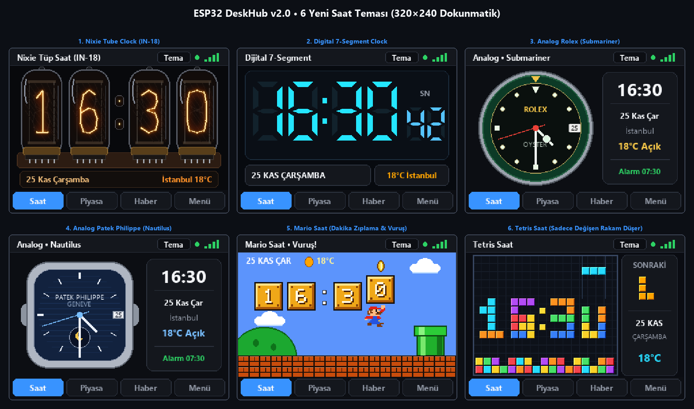
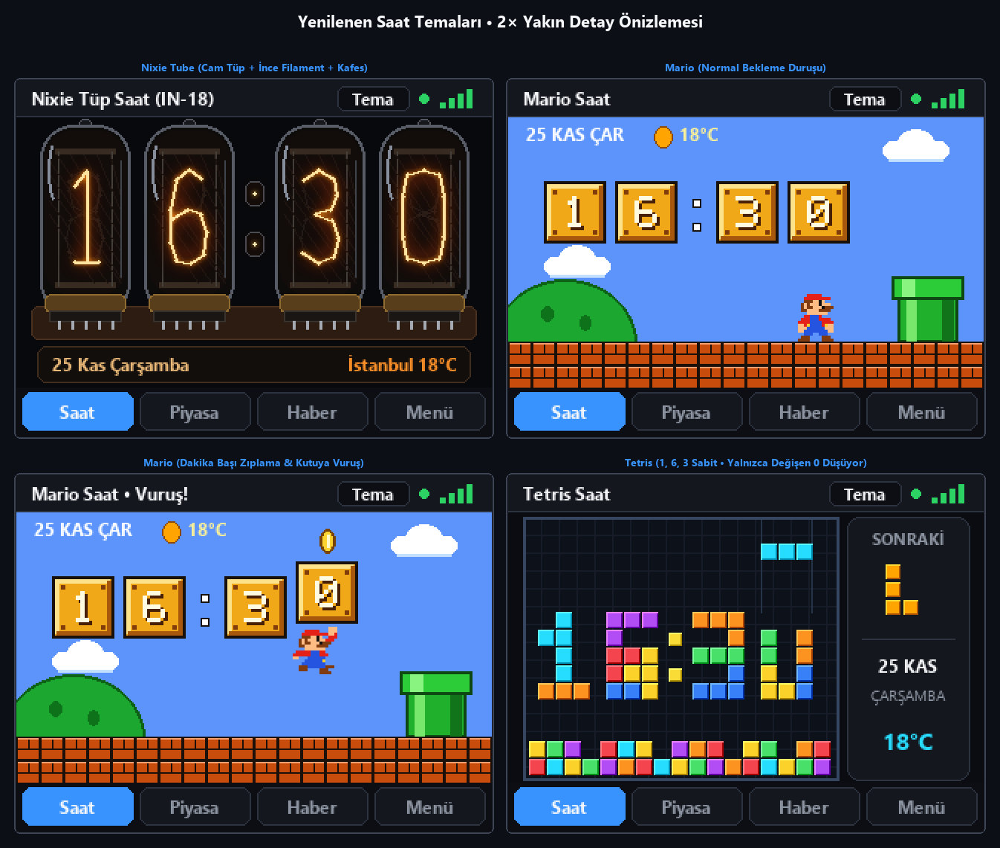
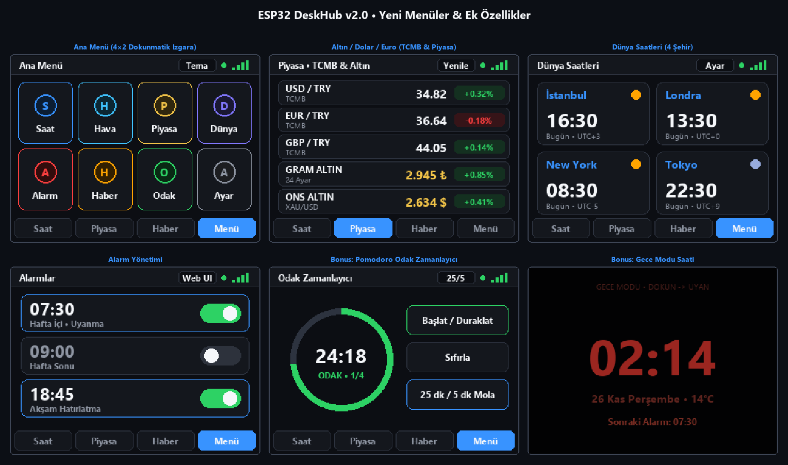
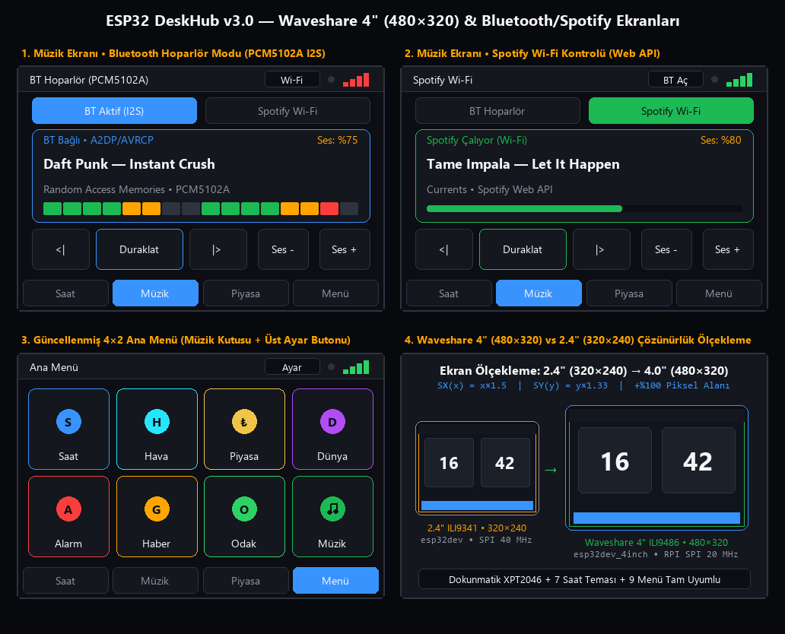
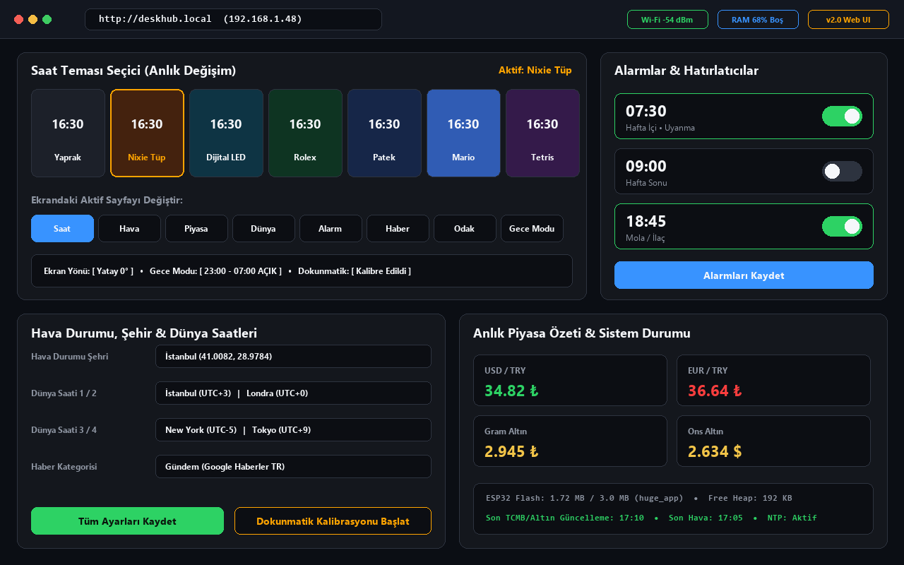
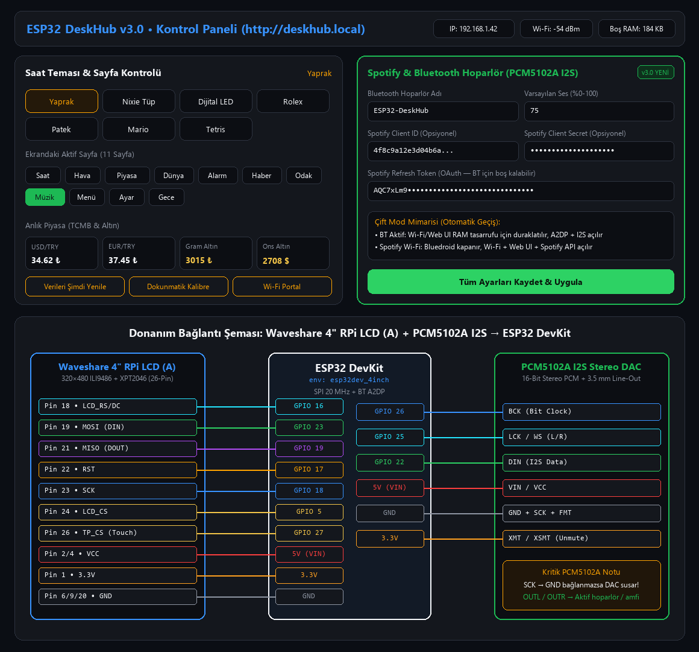
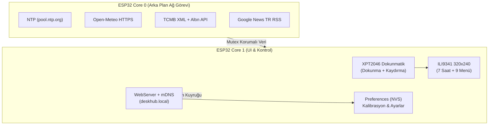
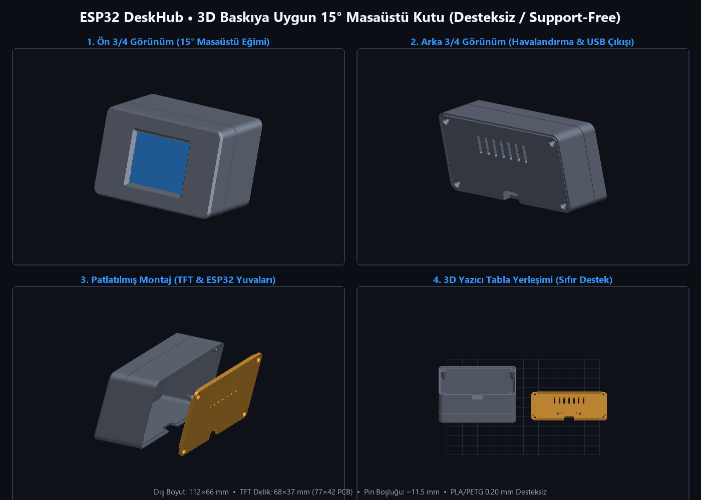

# ESP32 DeskHub v4.0 — Dokunmatik Masaüstü TFT Bilgi Ekranı & Wi-Fi OTA / BT Ses İstasyonu

<p align="center">
  
  
  
  
  
</p>

**2.4" 320×240 (`TJCTM24024-SPI` ILI9341)** ve **Waveshare 4" 480×320 (`RPi LCD (A)` ILI9486 + XPT2046)** ekranlar, **PCM5102A I2S DAC** ses çıkışı, **Bluetooth Classic A2DP Hoparlör / AVRCP** ve **Spotify Web API** desteğiyle çalışan, tamamen dokunmatik ve dahili **Web UI (`http://deskhub.local`)** kontrollü masaüstü bilgi istasyonu.

---

## Canlı Animasyonlar (GIF)

| Yaprak Saat (3D Gölgeli Dönüş) | Mario Saat (Dakika Zıplama & Kutu Vuruşu) | Tetris Saat (Yalnızca Değişen Hane Düşer) |
|:---:|:---:|:---:|
|  |  |  |

---

## Özellikler

### 7 Farklı Saat Teması
1. **Yaprak Saat (Flip Clock):** Her dakika/saat değişiminde 3D gölgeli mekanik yaprak dönme animasyonu, Türkçe tarih, alt hava özeti ve 60 sn ilerleme barı.
2. **Nixie Tüp Saat (IN-18):** Üst cam mühür ucu, cam yansımaları, mika tutucular, anod kafesi, sönük katot telleri, pirinç soket pinleri ve ince tel-filament neon parlama.
3. **Dijital 7-Segment LED:** Saniyeli yüksek kontrastlı camgöbeği LED göstergeler.
4. **Analog Rolex (Submariner):** Zümrüt-siyah diver bezel, Mercedes akrep, büyüteçli tarih penceresi ve sağda dijital özet paneli.
5. **Analog Patek Philippe (Nautilus):** Sekizgen çelik kasa, yatay şeritli lacivert kadran, 6 yönünde ay evresi alt kadranı.
6. **Mario Saat:** Orijinal 16×16 NES Mario piksel karakteri ve 42×42 `?` blokları; dakika başı Mario zıplayarak dakika kutusuna alttan vurur, kutu yukarı seker ve sikke çıkar.
7. **Tetris Saat:** Değişmeyen rakamlar sabit kalır; sadece değişen hanenin çok renkli tetromino parçaları yukarıdan düşerek rakamı oluşturur.



<details>
<summary>2× Yakın Detay Görseli (Nixie, Mario Bekleme/Vuruş ve Tetris)</summary>



</details>

---

### Yeni Menüler & Akıllı Araçlar

- **Ana Menü & v4.0 Akıllı Kontroller:**
  - **Altta İnteraktif 9 Sayfalık Sürgü (`Saat • Hava • Piyasa • Dünya • Alarm • Haber • Odak • Müzik • Menü`):** Parmağı sürükleyerek anlık önizleme ve bırakınca doğrudan o sayfaya geçiş (veya ray üzerine dokunma).
  - **Aydınlık & Karanlık Tema:** Ana Menü, Ayarlar ve Web UI (`deskhub.local`) üzerinden hem ekran arayüzünü hem Web UI panelini anlık `Karanlık` / `Aydınlık` moda geçirme (NVS'e kaydedilir).
  - **45 sn Otomatik Döngü (`Saat → Hava Durumu → Piyasa`):** Ana Menü veya Web UI'dan tek dokunuşla açılıp kapanır; 45 saniyede bir saat, hava ve piyasa arasında otomatik döner (ekrana dokunulduğunda sayaç sıfırlanır, diğer sayfalarda bekler).
  - **Wi-Fi ile Güncelleme (OTA):** `deskhub.local` Web UI üzerinden tarayıcıdan `.bin` yükleme (`/api/ota`) ve PlatformIO `ArduinoOTA` (`--upload-port deskhub.local`) desteği.
- **Müzik, Bluetooth Hoparlör & Spotify:**
  - **Bluetooth A2DP Hoparlör Modu (`PCM5102A I2S DAC`):** ESP32 Classic hedeflerinde (`esp32dev`, `esp32dev_4inch`) telefonunuzdan `ESP32-DeskHub` adıyla doğrudan ses akışı, AVRCP şarkı/sanatçı bilgisi, `<|`, `Oynat/Duraklat`, `|>`, ses kıs/aç ve canlı 16 segment stereo VU metre. *(ESP32 RAM sınırları gereği BT Hoparlör modunda Wi-Fi geçici kapatılır; `Wi-Fi` / `Spotify Wi-Fi` butonuna dokununca anında Wi-Fi moduna dönülür.)*
  - **Spotify Wi-Fi Kontrolü:** Web UI üzerinden opsiyonel `Client ID`, `Client Secret` ve `Refresh Token` girildiğinde Wi-Fi modunda çalan parçayı, ilerleme çubuğunu ve uzaktan oynatma/ses kontrollerini sunar.
  - **I2S Alarm Melodisi:** Wi-Fi modunda alarm çaldığında PCM5102A üzerinden tatlı çift tonlu uyandırma melodisi üretir.
- **Ana Menü (4×2 Dokunmatik Izgara):** Alt bardaki `Menü` sekmesinden tüm uygulamalara tek dokunuşla erişim (ayarlar sağ üst `Ayar` butonundadır).
- **Hava Durumu (Open-Meteo):** API anahtarsız anlık sıcaklık, hissedilen, nem, rüzgar, vektörel ikonlar ve 3 günlük Türkçe tahmin.
- **Piyasa (TCMB & Altın):** Resmi `tcmb.gov.tr/kurlar/today.xml` üzerinden `USD/TRY`, `EUR/TRY`, `GBP/TRY` + canlı `Ons Altın ($)` ve `Gram Altın (₺)`.
- **Dünya Saatleri:** Web UI'dan özelleştirilebilen 4 şehir (varsayılan: İstanbul, Londra, New York, Tokyo) + gündüz/gece göstergesi.
- **Alarmlar:** 3 bağımsız alarm (`Her Gün` / `Hafta İçi` / `Hafta Sonu`), ekranda dokunmatik saat/dakika düzenleme, `5 dk Ertele` ve opsiyonel pasif buzzer çıkışı.
- **Google Haberler (TR RSS):** Gündem, Teknoloji, Ekonomi, Bilim ve Spor kategorilerinde Türkçe manşetler (`< Önceki` / `Konu Değiş` / `Sonraki >`).
- **Odak Zamanlayıcı (Pomodoro):** `25/5 dk` ve `50/10 dk` dairesel ilerleme halkalı çalışma sayacı.
- **Gece Modu Saati:** Belirlenen saat aralığında göz yormayan düşük parlaklıklı kırmızı gece saati (dokununca 2 dakika uyanır).



### v3.0 • Waveshare 4" (`480×320`), Bluetooth Hoparlör (`PCM5102A`) & Spotify



---

### Dahili Web UI (`http://deskhub.local`) & Donanım Şeması

ESP32 aynı ağa bağlandığında `http://deskhub.local` (veya cihazın yerel IP adresi) üzerinden açılan modern karanlık tema kontrol paneli:
- 7 saat temasını ve ekrandaki aktif sayfayı tek tıkla anlık değiştirme
- 3 alarmı, 4 dünya şehrini, hava durumu şehrini/koordinatını ve haber kategorisini düzenleme
- Gece Modu saat aralığı, ekran döndürme (`0° / 180°`) ve buzzer GPIO ayarı
- Anlık TCMB/Altın kurları, Wi-Fi sinyal gücü ve RAM telemetrisi
- Uzaktan dokunmatik kalibrasyon, veri yenileme ve kurulum portalı tetikleme





---

## Sistem Mimarisi



---

## Donanım Bağlantı Şeması (`TJCTM24024-SPI`)

Ekran ve dahili **XPT2046 dokunmatik kontrolcüsü** aynı SPI hattını farklı `CS` pinleriyle paylaşır (harici buton veya rotary encoder gerekmez).

| Ekran Pini | ESP32 DevKit / NodeMCU-32S (`esp32dev`) | ESP32-C3 Mini (`esp32c3`) | Açıklama |
|---|---|---|---|
| `VCC` | **5V (VIN)** | **5V (VBUS)** | Kart arkasındaki `U1` (3.3V regülatör) için 5V |
| `GND` | `GND` | `GND` | Ortak şase |
| `CS` | `GPIO 5` | `GPIO 7` | TFT Chip Select |
| `RESET` | `GPIO 17` | `GPIO 3` | TFT Reset |
| `DC` | `GPIO 16` | `GPIO 2` | Data / Command |
| `SDI (MOSI)` | `GPIO 23` | `GPIO 6` | SPI MOSI |
| `SCK` | `GPIO 18` | `GPIO 4` | SPI SCLK |
| `LED` | **3.3V** | **3.3V** | Arka ışık (`3.3V` bağlayın) |
| `SDO (MISO)` | `GPIO 19` | `GPIO 5` | SPI MISO |
| `T_CLK` | `GPIO 18` | `GPIO 4` | `SCK` ile paralel |
| `T_CS` | `GPIO 27` | `GPIO 10` | Dokunmatik Chip Select |
| `T_DIN` | `GPIO 23` | `GPIO 6` | `SDI (MOSI)` ile paralel |
| `T_DO` | `GPIO 19` | `GPIO 5` | `SDO (MISO)` ile paralel |
| `T_IRQ` | *Boş* | *Boş* | Bağlanmaz (yoklama modu) |

### Waveshare 4" RPi LCD (A) `320×480 ILI9486 + XPT2046` (`esp32dev_4inch`)

Waveshare 4" RPi LCD (A) ekranın **26-pin GPIO konnektöründen** ESP32 DevKit'e bağlantısı (`RPI_DISPLAY_TYPE` shift-register uyumlu, SPI hızı **20 MHz** ile sınırlandırılmıştır):

| Waveshare 26-Pin | Sinyal | ESP32 DevKit (`esp32dev_4inch`) | Açıklama |
|---|---|---|---|
| Pin `1 / 17` | `3.3V` | `3.3V` (veya Pin `2/4` → `5V`) | Modül kartındaki regülatöre göre `5V` (`Pin 2`) + `3.3V` (`Pin 1`) |
| Pin `6 / 9 / 14 / 20 / 25` | `GND` | `GND` | Ortak şase |
| Pin `18` | `LCD_RS / DC` | `GPIO 16` | Data / Command |
| Pin `19` | `MOSI (DIN)` | `GPIO 23` | Paylaşılan SPI MOSI (TFT + Touch) |
| Pin `21` | `MISO (DOUT)` | `GPIO 19` | Paylaşılan SPI MISO (TFT + Touch) |
| Pin `22` | `RST` | `GPIO 17` | LCD Reset |
| Pin `23` | `SCK` | `GPIO 18` | Paylaşılan SPI SCLK |
| Pin `24` | `LCD_CS` | `GPIO 5` | TFT Chip Select |
| Pin `26` | `TP_CS` | `GPIO 27` | XPT2046 Dokunmatik CS |


<details>
<summary>Gerçek Kart Fotoğrafı Üzerinde 26-Pin Haritası (Rev2.0)</summary>


</details>

### PCM5102A I2S Stereo DAC Bağlantısı (`esp32dev` / `esp32dev_4inch`)

| PCM5102A Pini | ESP32 DevKit Pini | Açıklama |
|---|---|---|
| `VIN / VCC` | `5V` (veya `3.3V` modüle göre) | Güç beslemesi |
| `GND` | `GND` | Ortak şase |
| `SCK` | **`GND`** | Dahili PLL kullanılır (`GND`'ye bağlanmazsa ses gelmez!) |
| `BCK` | `GPIO 26` | I2S Bit Clock |
| `LCK / WS` | `GPIO 25` | I2S Left/Right Word Select |
| `DIN` | `GPIO 22` | I2S Data Out (ESP32 → DAC) |
| `FMT` | `GND` | Standart I2S formatı |
| `XMT / XSMT` | `3.3V` | Mute kapalı (aktif çıkış; 10k dirençle 3.3V veya doğrudan 3.3V) |
| `OUTL / OUTR` | `3.5 mm Jak / Amfi` | Hat seviyesi (Line-Out) aktif hoparlör/amfi bağlantısı |

*(Not: `ESP32-C3 Mini` üzerinde Bluetooth Classic donanımı olmadığı için `HAS_BT_SPEAKER=0` tanımlıdır; yalnızca Wi-Fi üzerinden Spotify kontrolü aktiftir.)*

---

## Dokunmatik Kullanım & İlk Kurulum

1. **İlk Kalibrasyon:** Cihaz ilk açılışta 4 köşe dokunmatik kalibrasyonu ister. Oklara sırayla dokunduğunuzda kalibrasyon NVS belleğe kaydedilir.
2. **Wi-Fi Kurulumu:** Kayıtlı ağ yoksa cihaz **`ESP32-DeskHub`** adlı şifresiz Wi-Fi ağı açar. Bağlanıp **`http://192.168.4.1`** adresinden Wi-Fi ve şehrinizi kaydedin.
3. **Alt İnteraktif Sayfa Sürgüsü (`Saat ↔ Menü`):** Alt çubuktaki sürgüyü sağa/sola kaydırıp bırakarak veya noktalara dokunarak 9 ana sayfanın tamamına (`Saat`, `Hava`, `Piyasa`, `Dünya`, `Alarm`, `Haber`, `Odak`, `Müzik`, `Menü`) anında geçin. Menü ekranındayken **`45sn Döngü`**, **`Tema: Aydınlık/Karanlık`** ve sağ üst **`[Ayar]`** butonlarına erişebilirsiniz.
4. **Saat Ekranı Kısayolları:**
   - Sağ üst **`[Tema]`** butonu → 7 saat teması arasında geçiş
   - Dakika tarafına dokunma → aktif temanın animasyon demosu (Yaprak dönüş / Mario zıplama-vuruş / Tetris düşüş)
   - Saat tarafına dokunma → NTP + Hava + Piyasa yenileme
   - Alt tarih/hava bandına dokunma → Hava Durumu sayfası

---

## Web UI REST API

| Uç Nokta | Metot | Açıklama |
|---|---|---|
| `/` | `GET` | Tek sayfalık Aydınlık/Karanlık uyumlu Web UI |
| `/api/state` | `GET` | Tema, aydınlık/karanlık, döngü, OTA durumu, sayfa, alarmlar, dünya saatleri ve piyasa JSON |
| `/api/theme?id=0..6` | `POST` | Saat temasını anlık değiştirir ve NVS'e kaydeder |
| `/api/page?id=0..10` | `POST` | Ekrandaki aktif sayfayı değiştirir |
| `/api/ui?light=0\|1&cyc=0\|1` | `POST` | Aydınlık/Karanlık tema ve 45 sn döngü modunu anlık açar/kapatır |
| `/api/ota` | `POST` | Tarayıcıdan multipart `.bin` firmware yükleyerek Wi-Fi OTA günceller (`ota_nofs_4MB.csv`) |
| `/api/config` | `POST` | Şehir, koordinat, haber, alarmlar, dünya saatleri, gece modu, yön ve buzzer kaydı |
| `/api/action?cmd=...` | `POST` | `refresh`, `calibrate`, `portal`, `restart` komutları |

---

## 3D Baskı Kutu (`enclosure/`)

Desteksiz (support-free) basılabilen, `112×66×44 mm` boyutlu, `68×37 mm` (`77×42 mm` PCB) TFT delik aralıklı ve **14-pin `J2` / DuPont kablo için ~11.5 mm yan + ekstra derinlik boşluklu** 15° eğimli **PLA/PETG** kasa dosyaları `enclosure/stl/` içindedir:



| Parça | Dosya | Baskı Ayarı |
|---|---|---|
| Ön Gövde | [`enclosure/stl/deskhub_front_shell.stl`](enclosure/stl/deskhub_front_shell.stl) | `0.20 mm`, `%18` dolgu, **Desteksiz** (~39 g) |
| Arka Kapak | [`enclosure/stl/deskhub_back_cover.stl`](enclosure/stl/deskhub_back_cover.stl) | `0.20 mm`, `%18` dolgu, **Desteksiz** (~15 g) |
| Parametrik SCAD | [`enclosure/deskhub_enclosure.scad`](enclosure/deskhub_enclosure.scad) | OpenSCAD ile özelleştirilebilir (`68×37 mm` @ `cx=-3.5 mm`) |

- **Vida Listesi:** `4× M3×6` (TFT montajı) + `4× M3×8` havşalı (arka kapak).

---

## Derleme ve Yükleme (PlatformIO)

Proje **4 MB Flash** üzerinde **iki farklı partisyon profili** sunar:

| Ortam (`env`) | Ekran & İşlemci | Wi-Fi OTA | BT A2DP Hoparlör | Partisyon |
|---|---|---|---|---|
| `esp32dev` | 2.4" `320×240` ILI9341 (`ESP32`) | Açık (`Web + ArduinoOTA`) | Kapalı | `ota_nofs_4MB.csv` |
| `esp32dev_4inch` | Waveshare 4" `480×320` ILI9486 (`ESP32`) | Açık (`Web + ArduinoOTA`) | Kapalı | `ota_nofs_4MB.csv` |
| `esp32c3` | 2.4" `320×240` ILI9341 (`ESP32-C3`) | Açık (`Web + ArduinoOTA`) | Yok | `ota_nofs_4MB.csv` |
| `esp32dev_bt` | 2.4" `320×240` ILI9341 (`ESP32`) | Kapalı | Açık (`PCM5102A`) | `huge_app.csv` |
| `esp32dev_4inch_bt` | Waveshare 4" `480×320` ILI9486 (`ESP32`) | Kapalı | Açık (`PCM5102A`) | `huge_app.csv` |

*(Not: 4 MB cihazda Wi-Fi OTA özelliğini aktifleştirmek için yeni `ota_nofs_4MB.csv` partisyon tablosunun **ilk seferlik** USB üzerinden yüklenmesi gerekir; sonrasındaki tüm güncellemeler `http://deskhub.local` veya `--upload-port deskhub.local` üzerinden kablosuz yapılabilir.)*

**Wi-Fi OTA Yükleme Örneği (`esp32dev` veya `esp32dev_4inch`):**
```powershell
pio run -e esp32dev -t upload --upload-port deskhub.local
```

**USB İlk Kurulum / Klasik Yükleme:**

**Waveshare 4" (`480×320`, `ILI9486`) + ESP32 DevKit (`esp32dev_4inch`):**
```powershell
pio run -e esp32dev_4inch
pio run -e esp32dev_4inch -t upload
```

**2.4" (`320×240`, `ILI9341`) + ESP32 DevKit / NodeMCU-32S (`esp32dev`):**
```powershell
pio run -e esp32dev
pio run -e esp32dev -t upload
```

**ESP32-C3 Mini (`esp32c3`):**
```powershell
pio run -e esp32c3
pio run -e esp32c3 -t upload
```

**Türkçe Fontları veya Dokümantasyon Görsellerini Yeniden Üretmek İçin:**
```powershell
python tools/generate_fonts.py
python tools/render_docs_media.py
```
